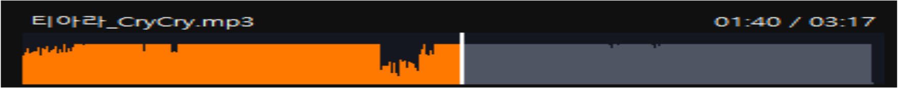
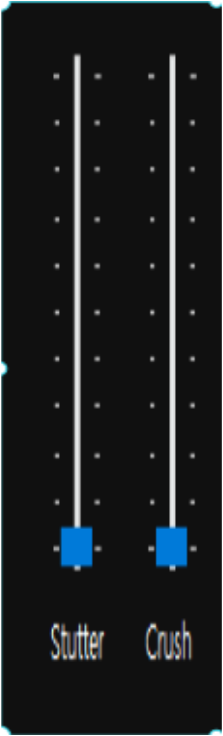
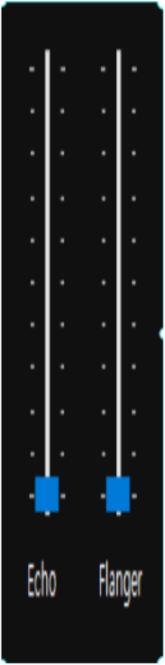
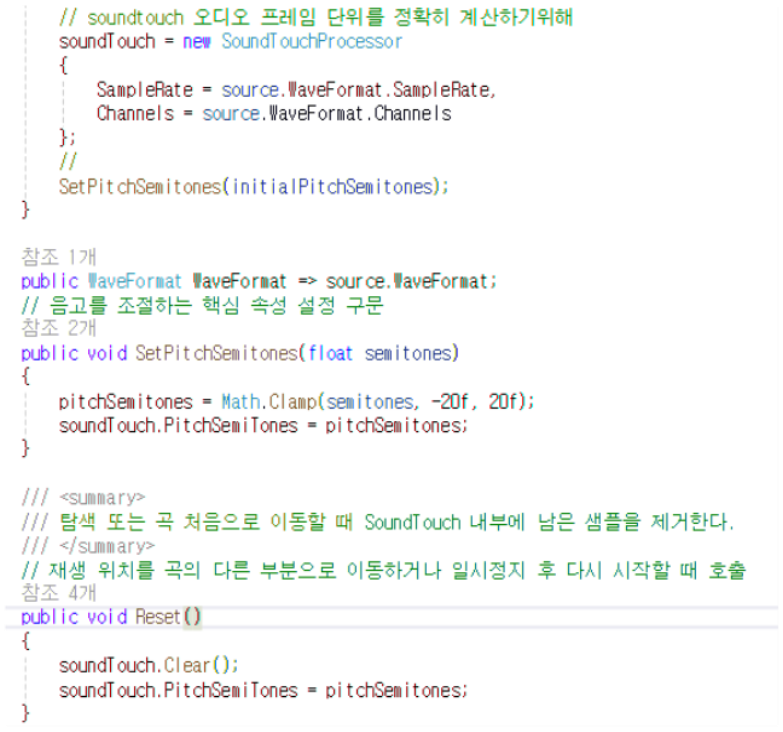
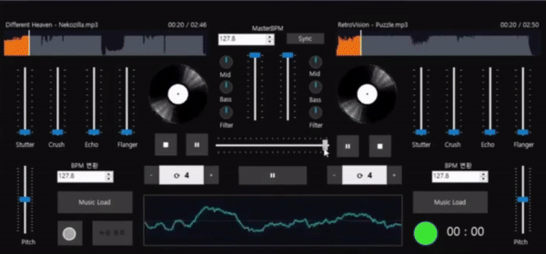
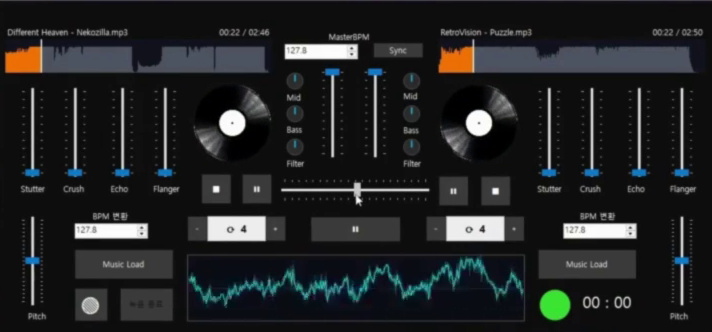
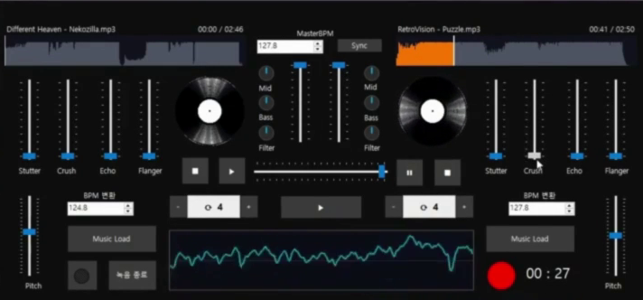
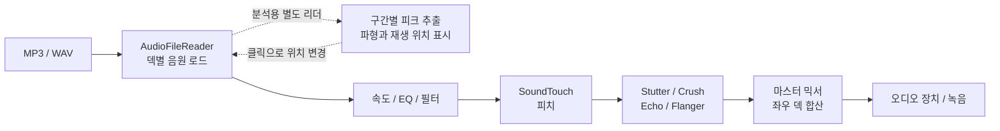

# 🎧 1차 프로젝트 | DJing 미디어 플레이어

**두 곡을 동시에 재생하고, 파형을 보면서 재생 위치와 음색을 조절하는 C# WinForms 팀 프로젝트입니다.** DJ 믹싱과 함께 음원 검색·업로드, 좋아요, 댓글, 재생목록 기능을 제공합니다.


[조영준의 구현 기여](#-조영준의-구현-기여) · [시연](#-시연) · [팀 프로젝트 주요 기능](#-팀-프로젝트-주요-기능) · [실행 방법](#-실행-방법)

## 🎛️ 조영준의 구현 기여

좌우 덱에 **오디오 파형, 클릭으로 구간 이동, 이펙트와 피치 조절**을 구현했습니다.

### 오디오 파형과 구간 이동



NAudio로 음원을 읽어 화면 너비에 맞춘 각 구간의 최대 진폭을 막대 높이로 표시했습니다. 재생한 구간과 남은 구간을 색으로 구분하고, 재생 중에는 30ms 간격으로 화면 갱신을 요청합니다. 파형을 클릭하면 가로 좌표를 곡 전체 길이에 대한 비율로 바꿔 해당 위치로 이동하도록 했습니다.

### 덱별 이펙트

| Stutter · Crush | Echo · Flanger |
| :---: | :---: |
|  |  |

| 이펙트 | 구현 방식 |
| --- | --- |
| **Stutter** | 순환 버퍼에 저장한 최근 샘플의 짧은 구간을 반복합니다. |
| **Crush** | 샘플 값을 일정 간격으로 유지하고 진폭을 양자화해 거친 음색을 만듭니다. |
| **Echo** | 250ms 지연된 소리를 원음과 섞고, 지연 신호를 버퍼에 다시 넣어 반복음을 만듭니다. |
| **Flanger** | 사인파에 따라 짧은 지연 시간을 바꾸고 지연된 소리를 원음에 섞습니다. |

좌우 덱에서 효과를 각각 조절할 수 있습니다. 한 덱에서 효과를 켜면 같은 덱의 다른 세 효과가 초기화됩니다. 슬라이더를 더블클릭하면 해당 효과를 끌 수 있습니다.

### 피치 조절

SoundTouch를 사용해 재생 속도 설정과 별도로 음높이를 **−20~+20반음** 조절하도록 했습니다. 구간을 이동할 때는 변환 버퍼를 비운 뒤 설정한 피치 값을 다시 적용합니다.



[원본 코드 캡처와 소스 파일별 구현 설명](docs/AUDIO-IMPLEMENTATION.md)

## 🎬 시연

[](demo/mixing-demo.mp4)

[▶ 파형 탐색과 이펙트 조작 시연 영상](demo/mixing-demo.mp4) · 팀 시연 영상에서 믹싱 화면을 발췌한 31초 무음 영상

| 덱별 파형과 재생 위치 | 오른쪽 덱 Crush 조절 |
| :---: | :---: |
|  |  |

## 📌 팀 프로젝트 주요 기능

| 영역 | 기능 |
| --- | --- |
| DJ 믹싱 | 좌우 덱 MP3·WAV 불러오기, 개별 재생, 볼륨과 크로스페이더, BPM 조절, EQ·필터, 자동 루프, 믹스 녹음 및 MP3 저장 |
| 음원 피드 | 곡 제목·아티스트 검색, 음원 재생, 재생 위치 이동, 좋아요와 댓글 |
| 업로드·마이페이지 | 음원과 앨범 커버 등록, 내 음원 정보 수정, 좋아요 목록 및 재생목록 조회 |
| 계정 | 회원가입, 로그인, 계정 찾기, 프로필 관리 |

## 🔄 오디오 처리 흐름



## 🛠️ 기술 스택과 소스

| 항목 | 기술 또는 위치 |
| --- | --- |
| 앱 UI | C#, Windows Forms, Visual Studio 2022 |
| 대상 프레임워크 | `net6.0-windows` |
| 오디오 재생·믹싱 | NAudio |
| 피치 조절 | SoundTouch.Net |
| 계정·피드 데이터 | MySQL, MySql.Data |
| 솔루션 | [src/DJing.sln](src/DJing.sln) |
| 파형 추출·그리기·탐색 | [WaveFormDeck.cs](src/WaveFormDeck.cs) |
| 샘플 이펙트 | [GlitchStutterProvider.cs](src/GlitchStutterProvider.cs) |
| 피치 처리 | [SoundTouchSampleProvider.cs](src/SoundTouchSampleProvider.cs) |
| 믹싱 화면과 컨트롤 이벤트 | [DJform.cs](src/DJform.cs) |

## 🔧 실행 방법

Windows에서 .NET SDK, **.NET 6 Windows Desktop Runtime**과 오디오 출력 장치를 준비합니다. Visual Studio에서 열려면 **.NET 데스크톱 개발** 워크로드가 필요합니다.

### DJ 믹싱만 실행

공개본에 추가한 `--mixing` 옵션으로 DB 설정 없이 DJ 믹싱 화면을 열 수 있습니다.

```powershell
git clone https://github.com/joyeongjun/1st-project.git djing
cd djing
dotnet run --project src/DJing.csproj -- --mixing
```

1. 왼쪽 또는 오른쪽 덱에서 **Music Load**를 눌러 로컬 MP3 또는 WAV를 선택합니다.
2. **▶**로 재생하고, 상단 파형을 클릭해 다른 구간으로 이동합니다.
3. 효과 슬라이더를 하나씩 올려 소리를 비교합니다. **Pitch** 슬라이더에서 음높이를 바꿔 볼 수 있습니다.

### 계정·피드를 포함한 실행

팀 프로젝트에서 사용한 MySQL 스키마를 복원한 뒤, PowerShell에서 해당 연결 문자열을 설정합니다. 제공 자료에는 DB 초기화 SQL이 없어 그 스키마가 따로 필요합니다.

```powershell
$env:DJING_MYSQL_CONNECTION_STRING = 'Server=localhost;Port=3306;Database=djing;Uid=<사용자>;Pwd=<비밀번호>;CharSet=utf8mb4;'
dotnet run --project src/DJing.csproj
```

Release 빌드와 DB 없는 믹싱 화면 초기화를 확인했습니다. 스테레오 WAV로 파형 추출과 구간 탐색을 검증했고, 피치를 설정한 상태에서도 정확한 위치로 이동하는지 확인했습니다. .NET 6 지원 종료 및 일부 패키지의 대상 프레임워크 관련 경고가 출력됩니다. 계정·피드 기능은 팀 DB 스키마가 없어 통합 실행을 확인하지 못했습니다.
