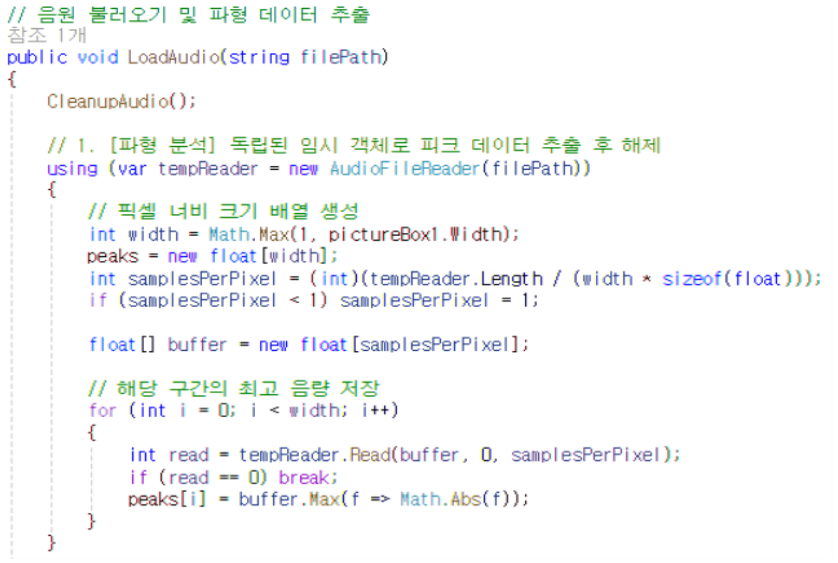
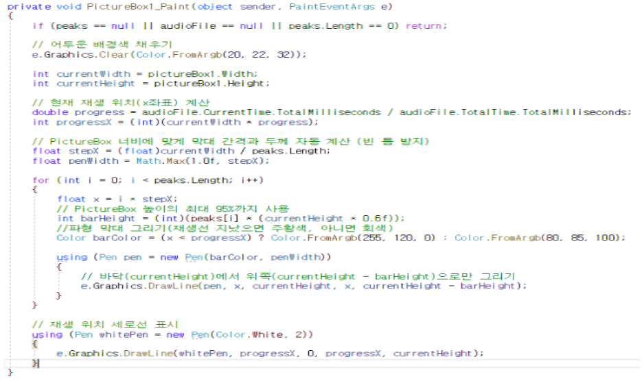
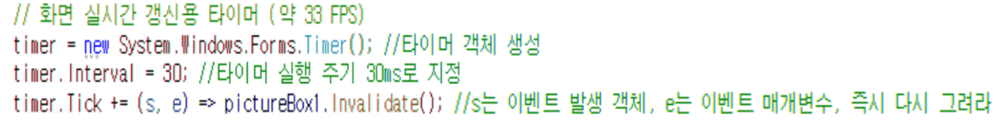
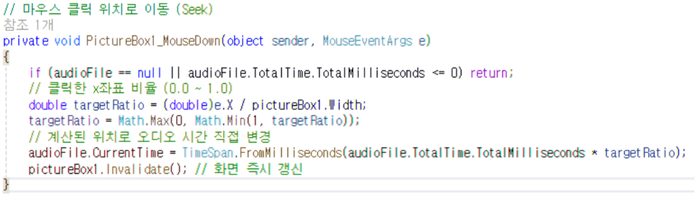
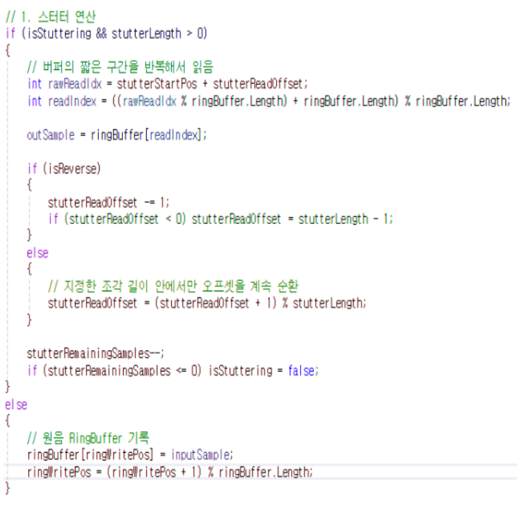
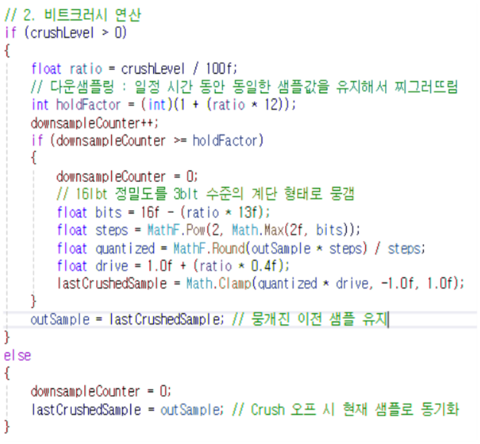
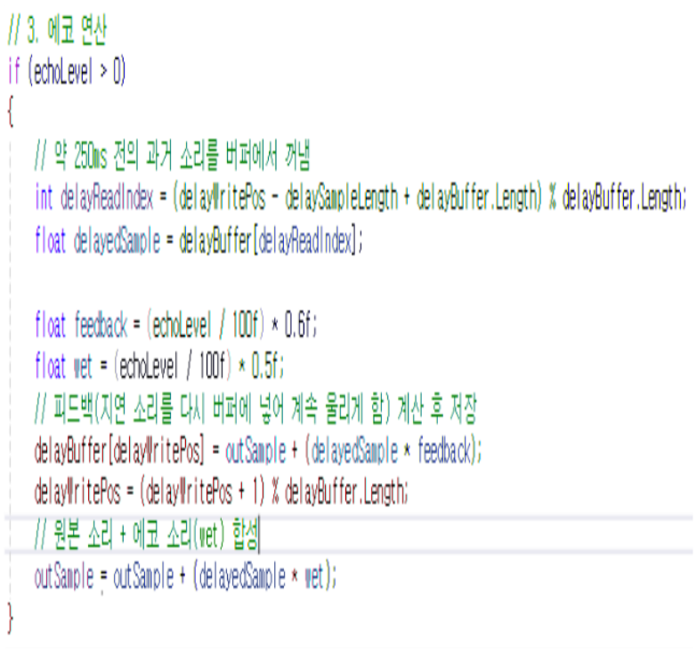
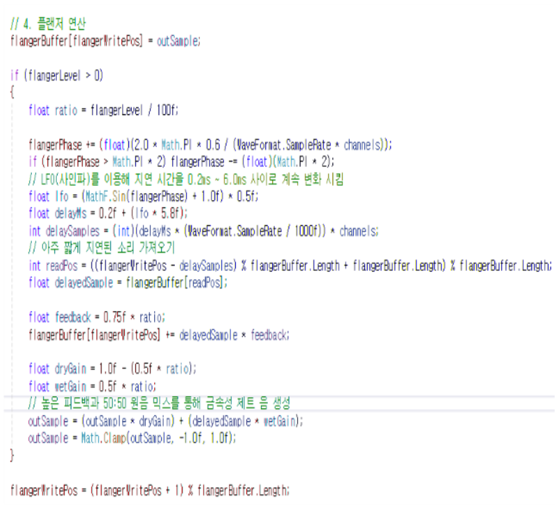
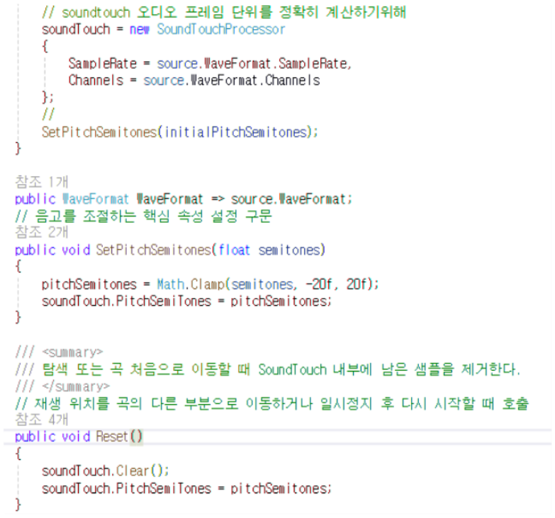
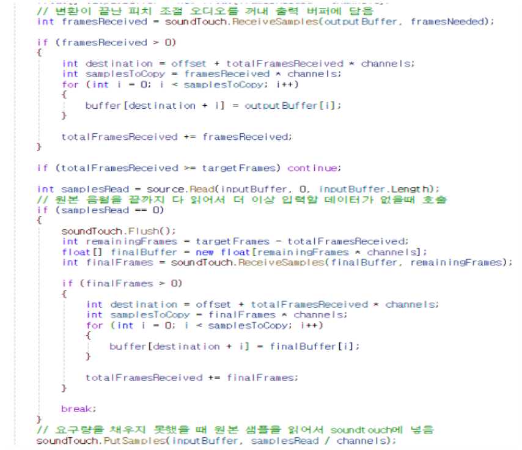

# 오디오 파형과 이펙트 구현

조영준이 맡은 DJ 믹싱 기능의 원본 코드 캡처와 현재 소스입니다.

## 파형 표시와 구간 탐색

[`WaveformDeck.LoadAudio`](../src/WaveFormDeck.cs)는 분석용 `AudioFileReader`로 곡을 읽어, 파형 영역의 너비에 맞춰 프레임을 나눕니다. 구간마다 최대 진폭만 보관하므로 화면을 다시 그릴 때마다 전체 음원을 읽지 않아도 됩니다. 실제 재생은 별도의 리더에서 진행합니다. 공개본에서는 스테레오 WAV도 완전한 프레임 단위로 읽도록 보완했습니다.

`DrawWaveform`은 현재 시간과 전체 길이의 비율로 재생 위치를 계산합니다. 위치선 왼쪽과 오른쪽의 막대 색을 구분해, 전체 곡에서 현재 위치를 바로 찾을 수 있습니다. 재생 중에는 WinForms 타이머가 30ms 간격으로 다시 그리기를 요청합니다.

`SeekByRatio`는 클릭한 X 좌표를 파형 너비로 나눠 이동 비율을 구하고 0~1 범위로 제한합니다. `전체 길이 × 이동 비율`을 재생 위치에 반영하고, 피치 변환 버퍼를 초기화한 뒤 화면을 갱신합니다.

파형 추출과 화면 그리기 코드

화면 갱신과 클릭 탐색 코드

## 샘플 단위 이펙트

[`GlitchStutterProvider`](../src/GlitchStutterProvider.cs)는 NAudio의 `ISampleProvider`를 구현합니다. 재생 과정에서 들어오는 샘플을 읽고 아래 방식으로 바꾼 뒤 다음 처리 단계로 전달합니다.

| 이펙트 | 처리 방식 | 조작 결과 |
| --- | --- | --- |
| Stutter | 순환 버퍼에서 가장 최근 구간을 가져와 반복 재생합니다. | 슬라이더를 올릴수록 반복 구간이 짧아집니다. |
| Crush | 일정 구간 동안 이전 샘플 값을 유지하고, 진폭을 양자화합니다. | 강도를 높이면 음색의 손실과 왜곡이 더 두드러집니다. |
| Echo | 고정 지연 버퍼에서 250ms 전의 샘플을 읽고, 피드백을 버퍼에 되돌려 씁니다. | 강도를 높이면 지연음의 혼합과 피드백이 함께 늘어납니다. |
| Flanger | 0.6Hz 사인파로 지연 길이를 약 0.2~6ms 사이에서 바꾸고, 지연 신호에 피드백을 적용해 원음과 섞습니다. | 지연 시간이 움직이면서 주기적으로 음색이 변합니다. |

[`DJform.InitializeEffectTrackBars`](../src/DJform.cs)에서 좌우 덱의 컨트롤을 각각 연결합니다. 슬라이더 범위는 0~100입니다. 하나를 0보다 높이면 같은 덱의 다른 효과가 초기화되고, 해당 슬라이더를 더블클릭하면 값이 0으로 돌아갑니다.

Stutter와 Crush 코드

Echo와 Flanger 코드

## 피치 조절

[`SoundTouchSampleProvider`](../src/SoundTouchSampleProvider.cs)는 입력 오디오의 샘플 레이트와 채널 수를 SoundTouch에 전달합니다. 변환은 채널을 묶은 프레임 단위로 처리합니다. 입력이 끝나면 변환기에 남은 샘플을 꺼내 출력합니다.

`SetPitchSemitones`로 −20~+20반음 범위의 피치를 지정합니다. 0에 가까운 값은 입력을 그대로 통과시킵니다. 구간 이동 시 `Reset`으로 내부 버퍼를 비우고 기존 피치 값을 다시 설정합니다.

SoundTouch 설정과 오디오 프레임 변환 코드

## 직접 재현하기

1. [README의 DJ 믹싱 실행 명령](../README.md#dj-믹싱만-실행)으로 앱을 열고 두 덱에 음원을 불러옵니다.
2. 재생 중 파형의 중간을 클릭하고 위치선과 시간 표시가 함께 바뀌는지 확인합니다.
3. 한쪽 덱에서 Stutter → Crush → Echo → Flanger 순으로 각 슬라이더를 올려 소리를 비교합니다. 같은 덱에서 이전 슬라이더가 0으로 돌아가는지 확인합니다.
4. Pitch를 올리거나 내린 뒤 재생 위치를 바꿔 음높이 설정이 유지되는지 확인합니다.
